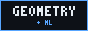
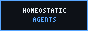

  <picture>
    <source media="(prefers-color-scheme: light)" srcset="assets/intro-light.gif">
    
  </picture>

I'm **Adarsh**, an engineering student at **Trinity College Dublin**.

I like problems that start with a simple model, turn into a mathematical question, and eventually force me  
to rethink the assumptions. Mostly interested in **geometry, machine learning, and efficient computation**.

### selected rabbit holes

**[01 / Riemannian Factor Dynamics](https://github.com/AdarshArunEire/Riemannian-Factor-Dynamics)** <- Current

*What if the reference frame of market factors move through time, and how do we isolate the real movement?*  
Moving baselines and the geometry of covariance data.

**[02 / Eigenvector Dynamics Beyond the RMT Null](https://github.com/AdarshArunEire/Eigenvector-Dynamics-Beyond-the-RMT-Null)**  

*Do the dominant eigenspaces of stock return covariance matrices rotate, and can we forcast with that rotation?*  
Signal, noise, and some useful negative results.

**[03 / Homeostatic Agents](https://github.com/AdarshArunEire/homeostatic-agents)**  

*What does an agent do when staying alive requires remembering where it's going?*  
Reinforcement learning, internal drives, and RL downfalls that ~~NEVER~~ don't always cooperate.

### on the side

`IEEE Signal Processing Cup '27` · `First year engineer` · `Huawei Tech Arena` · `and many more..`

  <a href="https://github.com/AdarshArunEire/Riemannian-Factor-Dynamics"><picture><source media="(prefers-color-scheme: light)" srcset="assets/buttons/geometry-light.png"></picture></a>
  <a href="https://github.com/AdarshArunEire/Eigenvector-Dynamics-Beyond-the-RMT-Null"><picture><source media="(prefers-color-scheme: light)" srcset="assets/buttons/eigen-light.png"></picture></a>
  <a href="https://github.com/AdarshArunEire/homeostatic-agents"><picture><source media="(prefers-color-scheme: light)" srcset="assets/buttons/agents-light.png"></picture></a>

  <a href="https://www.linkedin.com/in/adarsharun09"><picture><source media="(prefers-color-scheme: light)" srcset="assets/buttons/linkedin-light.png"></picture></a>
  <a href="mailto:aruna@tcd.ie"><picture><source media="(prefers-color-scheme: light)" srcset="assets/buttons/email-light.png"></picture></a>

